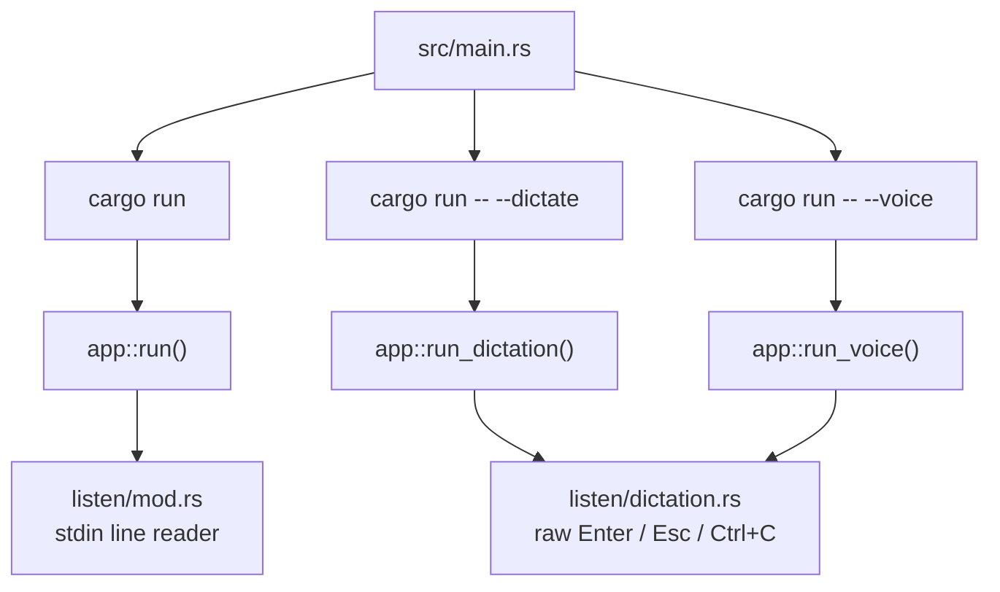
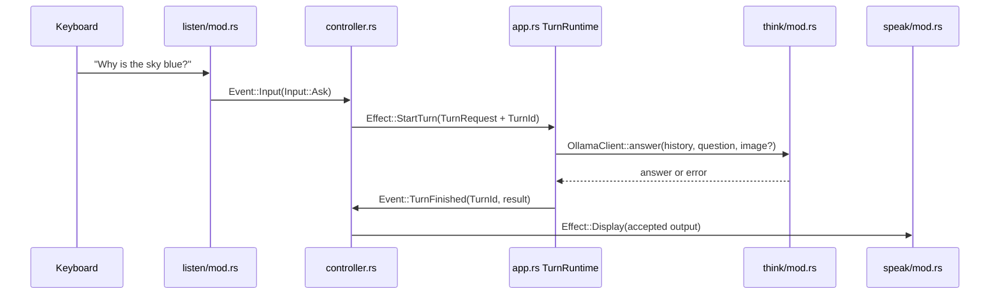
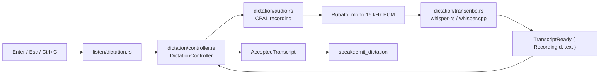
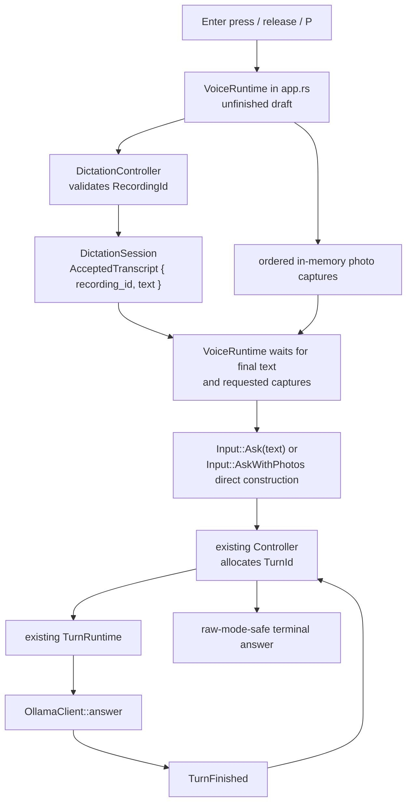

# Independence

Independence is an experiment in a local-first computer for noticing and
learning about the physical world. This repository currently contains a narrow
terminal prototype—not a finished camera device or general agent.

It can:

- take keyboard input as its `listen` capability;
- send a text question, or an ordered in-memory JPEG/PNG context plus a
  question, to a local Ollama model as `think`;
- list local Linux V4L2 cameras and explicitly capture one still image as
  `see` input;
- retain successfully accepted photographs, in attachment order, and
  conversation for follow-up questions as `see` context; and
- print an accepted answer as `speak`.

It also has two explicit local microphone modes:

- `--dictate` records one short clip, transcribes it with local Whisper, and
  displays the text only. It never contacts Ollama or invokes a command.
- `--voice` uses a real Enter press/release hold-to-talk flow, shows
  replaceable local partial transcripts, can attach still photos with `P`, and
  sends one literal question plus its ordered photos to the existing local
  Ollama/controller path. Spoken `/camera` and `/quit` text is never parsed as
  a terminal command.

The default observation mode (`cargo run`) does not access a microphone. No
current mode persists a conversation, streams tokens, calls tools
autonomously, or uses a cloud model.

## Start here

Read these files in this order:

1. [`VISION.md`](VISION.md) — why the project exists.
2. [`src/main.rs`](src/main.rs) — the tiny executable entry point.
3. [`src/app.rs`](src/app.rs) — runs input, worker tasks, and shutdown.
4. [`src/dictation/mod.rs`](src/dictation/mod.rs) and
   [`src/dictation/controller.rs`](src/dictation/controller.rs) — the separate
   dictation event loop and state machine.
5. [`src/controller.rs`](src/controller.rs) — the session state machine and
   result-acceptance rule.
6. [`src/think/mod.rs`](src/think/mod.rs) and
   [`src/think/teacher.txt`](src/think/teacher.txt) — Ollama transport and
   editable teaching guidance.
7. [`LEARNING.md`](LEARNING.md) — a walkthrough of one request and the Rust
   choices behind it.

## Run it on the same laptop

Run these commands from this repository root
(`/home/samebstein/code/independence` in the current checkout).

```bash
cargo run
```

This compiles the Rust package (writing only `target/`) and starts the
terminal app. It uses `http://127.0.0.1:11434` and the local non-thinking
vision model `qwen3-vl:4b-instruct` unless you set environment variables for
that one command:

```bash
OLLAMA_URL=http://127.0.0.1:11434 OLLAMA_MODEL=qwen3-vl:4b-instruct cargo run
```

This does not change shell configuration or Ollama settings. The model must
already be available from a running local Ollama server. If it is not, the app
reports the local connection failure rather than falling back to a cloud API.

`qwen3-vl:4b-instruct` retains text and image input but is a separate
non-thinking model variant. On this machine it answered a one-word prompt with
two generated tokens, while the installed `qwen3-vl:4b` thinking variant spent
hundreds of tokens reasoning first. To deliberately use that slower reasoning
variant again, set `OLLAMA_MODEL=qwen3-vl:4b` for one `cargo run` command.

If you need to install or download a model, do that deliberately outside this
project. For example, `ollama pull qwen3-vl:4b-instruct` uses the network and
consumes local disk space; it is not run automatically by this application.
Starting `ollama serve` starts a local service and binds its configured local
endpoint.

## Dictation and voice modes

Both microphone modes use local CPAL capture and local Whisper recognition.
They share the recording controls below, but have intentionally different
destinations for an accepted transcript. `--dictate` stops at terminal display
and has no Ollama or camera dependency at runtime. `--voice` sends an accepted
nonempty transcript directly to the existing text-question controller; it does
not parse it with the terminal command parser.

### One-time local prerequisites

On Linux Mint, CPAL's Linux microphone backend needs ALSA development headers.
Run this in your own terminal, from any directory:

```bash
sudo apt-get install libasound2-dev
```

This asks your package manager to install one system-wide development package
(and may use the network); it changes the system but does not open the
microphone or alter this repository. A successful install lets
`pkg-config --modversion alsa` print an ALSA version. Independence never runs
this command itself.

Dictation also needs one local Whisper model file. The CPU starting point is
the English `ggml-base.en.bin` file published in the
[whisper.cpp model repository](https://huggingface.co/ggerganov/whisper.cpp/tree/main).
It is about 148 MiB. Download it deliberately—using a browser or the command
below—from this repository root:

```bash
mkdir -p local-data/whisper
curl -L -o local-data/whisper/ggml-base.en.bin \
  https://huggingface.co/ggerganov/whisper.cpp/resolve/main/ggml-base.en.bin
```

The first command creates an ignored local-data directory. The second uses the
network and writes the model there; it does not modify source code or contact
Ollama. The default path is exactly `local-data/whisper/ggml-base.en.bin`.
To keep a model elsewhere, set `INDEPENDENCE_WHISPER_MODEL` only for the launch
command. The application does not download model weights automatically.

### Launch and controls

From the repository root, after the model file exists, start transcript-only
dictation with:

```bash
cargo run -- --dictate
```

Cargo compiles the package (writing `target/`) and starts raw-key dictation
mode. At READY it prints the selected microphone and Whisper model path. CPAL
chooses the system default input by default. To select a particular input by
its exact CPAL device name, use an environment variable for one launch:

```bash
INDEPENDENCE_MICROPHONE='Exact microphone name' cargo run -- --dictate
```

That command changes neither the default device nor shell configuration. If
the requested name is unavailable, READY reports the problem and recording
does not start.

To use the speech-to-controller bridge, first ensure the same local Ollama
setup described above is running, then launch:

```bash
cargo run -- --voice
```

This starts the same raw-key recording interface but constructs the normal
local Ollama runtime as well. It still uses the default
`qwen3-vl:4b-instruct` unless `OLLAMA_MODEL` is set for that one command. For
example, this selects both an input device and a model without changing system
defaults or shell configuration:

```bash
INDEPENDENCE_MICROPHONE='Exact microphone name' \
OLLAMA_MODEL=qwen3-vl:4b-instruct \
cargo run -- --voice
```

`--dictate` retains its original tap-Enter controls. `--voice` has separate,
button-controlled behavior and requires a terminal that supports Kitty/CSI-u
keyboard event reporting (including key release). It refuses to start rather
than guessing Enter release with a timeout.

| `--voice` state | Control | Result |
| --- | --- | --- |
| READY | Hold Enter | Immediately prints `independence: i'm listening`, opens the microphone, and begins bounded capture. A repeated key-down is ignored. |
| While Enter is held | `P` | Queues one immediate camera capture. Capture keeps the microphone running; successful stills remain only in memory and log their attachment count. |
| While Enter is held | Release Enter | Immediately prints `independence: i'm thinking`, releases the microphone, finishes final local transcription and already requested captures, then makes one model request. |
| While Enter is held | 30 seconds | Automatically finishes bounded capture; release is no longer needed. |
| Any unfinished voice work | Esc | Cancels recording, local recognition, queued/active photo capture, and model inference; late work cannot submit or print. Accepted context remains. |
| Any state | Ctrl+C | Cancels owned work, restores the terminal, and exits. |

Repeated Enter presses outside READY are ignored. The raw-key reader is the
only terminal input owner in either microphone mode; the normal line reader is
not running. The microphone stream is opened only after Enter and is dropped
before resampling or Whisper inference begins. Audio lives only in bounded
memory and is discarded after transcription or cancellation; Independence
writes no recordings to disk.

In `--voice`, Whisper has no command authority. While held, each complete
partial replaces the prior partial in memory and appears as `[log] transcript:
...`; it does not submit a turn. After `DictationController` accepts the final
current `RecordingId`, the runtime logs the exact final transcript, waits for
every requested photo, then constructs one `Input::Ask` or
`Input::AskWithPhotos` directly. The main controller then gives its model turn
a separate `TurnId`. A cancelled/stale recording, photo result, or model result
cannot bypass those ownership checks.

Pressing `P` chooses the only currently usable V4L2 camera, matching the
existing no-guess policy. If none or more than one camera is available, the
request logs a clear failure instead of choosing a device. Repeated presses are
allowed: captures are dispatched in press order. There is no three-photo
product limit; to keep unfinished drafts bounded, at most 32 captures may wait
and successfully attached bytes may total 64 MiB. Both resource rejections are
logged, and no image is written to disk.

Try this manual sequence:

1. Start `cargo run -- --dictate`, press Enter, say “The creek is loud after
   last night's rain,” then press Enter. Only the resulting transcript should
   appear.
2. Press Enter again, speak a few words, then press Esc. No text from that
   recording should appear.
3. Press Enter a third time, say a different short sentence, then press Enter.
   Only that third transcript should appear after the earlier successful one.

For `--voice`, try this separate sequence:

1. Start `cargo run -- --voice`, hold Enter, ask “What is the primary gas in
   Earth’s atmosphere?”, then release Enter. Partial `[log] transcript:` lines
   may appear while held; the final transcript and one model answer follow.
2. Hold Enter again, press `P` twice, describe what you want compared, then
   release Enter. Two `photo captured` logs should precede one request with two
   in-memory images in press order.
3. While holding Enter, press Esc. Then repeat during final transcription and
   while a model answer is pending. None of those unfinished results should
   print or alter the previously accepted conversation.

Current limits: English `base.en` recognition runs on CPU; no device list UI,
voice activity detection, saved audio, microphone permissions workflow,
text-to-speech, decision-model routing, photo permission loop, autonomous
camera decision, or spoken reply exists. Voice questions cannot use typed
`/look` or `/camera` commands; keep using the default keyboard mode for those.
Whisper cancellation is cooperative: Esc prevents a result from being
accepted, while the native recognizer exits at its next supported abort
callback point.

The camera code adds the Rust `v4l` crate for Linux V4L2 devices. Cargo may
download and compile it on the first build; this current Linux Mint machine
already compiled it using its existing toolchain. The application does not
install packages, alter `/dev/video*` permissions, or run as root. On another
machine, a build error about the C/Clang toolchain is a system-setup issue to
resolve deliberately outside this repository.

## Use the terminal prototype

```text
What is the primary gas in Earth's atmosphere?

/look data/tree.jpg | What might this tree be?
What detail would help distinguish it from an oak?

/cameras
/camera 0 | What visible features should I notice?
What should I inspect next?

/stop
/reset
/help
/quit
```

`/look` takes literal text before the first `|` as a path; it is never sent to
a shell. Spaces in paths work. A relative path is resolved from the directory
where Independence started. A literal `|` in the path is not supported because
it is the command delimiter.

The app reads at most 10 MiB, recognizes JPEG/PNG by content, and fully
decode-validates the image before any model request. It keeps the bytes only
in memory. A failed, cancelled, missing, oversized, or unsupported `/look`
does not replace the last accepted photograph or history.

### Camera commands (Linux V4L2)

Run `/cameras` first. It inspects `/dev/video*` nodes for the capture and
streaming capabilities this prototype supports, but does **not** start a
capture stream. It prints the numeric identifier and a kernel-provided name:

```text
independence: usable cameras:
  0  Laptop Camera: Laptop Camera  (/dev/video0)
```

Then use one of these literal commands:

```text
/camera | What visible features should I notice?
/camera 0 | What visible features should I notice?
```

The no-ID form works only when exactly one usable camera is listed. With two
or more entries, explicitly choose one; the application never guesses the
first `/dev/video*` node. A malformed ID, an ID not currently listed, no
camera, or ambiguous no-ID command reports an error before capture begins and
does not interrupt an unrelated active turn.

For an accepted camera turn, Independence requests a conservative MJPEG or
YUYV format at up to 1280×720, validates the format actually negotiated with
the driver, discards up to two warm-up frames, and keeps one final still in
memory. It emits the negotiated dimensions after capture, closes the V4L2
stream and device, restores the prior format when possible, and only then
contacts Ollama. YUYV frames are encoded as JPEG in memory; MJPEG frames are
fully validated as JPEG. No capture is written to disk or logged as payload
data.

Like `/look`, `/camera` stages a proposed new scene. The camera image and its
new history replace the accepted scene only after Ollama returns an accepted
answer. A failure or cancellation retains the previously accepted photo and
history. Follow-up questions use the last accepted camera image; they do not
activate the camera again.

`/stop` makes the application immediately reject the camera turn. A running
blocking V4L2 frame read cannot be safely killed by Tokio, so it is allowed to
finish its bounded three-second capture window and release its handle in the
background. A one-permit gate prevents repeated cancellations from piling up
camera workers or opening the device twice. The three-second bound applies to
the poll-based frame waits; V4L2 open/configuration ioctls are driver calls
without a separate timeout exposed by this backend, so a broken kernel driver
can still misbehave there. Independence does not claim to forcibly stop that
kind of driver failure.

### Small manual experiments

Start the app with `cargo run` from the repository root. For an explicit file
photo and follow-up, type:

```text
/look /home/samebstein/Downloads/testtree.jpeg | What visible features can help identify this tree?
What part of the image should I inspect next?
```

For a camera still, use the ID `/cameras` reported, then type:

```text
/camera 0 | What visible features should I notice?
What observation would reduce uncertainty?
```

To test cancellation, submit a camera question and type `/stop` while the
capture or local inference is active. The application should not print an
accepted answer or add an exchange. The camera may remain busy for up to the
three-second bounded acquisition window while its worker closes. To test an
error that must not alter an accepted scene, use a deliberately invalid file:

```text
/look /definitely/not/a/photo.jpeg | What is this?
```

`/stop` cancels the application-owned request task without adding a model
answer to history. It cannot prove that the independent Ollama server stopped
all of its computation immediately. `/reset` also cancels active work and
clears this application's in-memory scene/history; it does not erase the
source image, terminal scrollback, or server-side logs.

## Use your own server through SSH

The client intentionally accepts only loopback URLs. If `mrfoxybrown` is a
hostname your SSH configuration can resolve, create a tunnel in a separate
terminal:

```bash
ssh -N -L 127.0.0.1:11435:127.0.0.1:11434 mrfoxybrown
```

That command opens a persistent SSH connection and maps this laptop's
`127.0.0.1:11435` to the server's own loopback Ollama port. It requires a
network connection to that server and does not expose Ollama publicly. Leave
that terminal open, then run Independence from this repository root:

```bash
OLLAMA_URL=http://127.0.0.1:11435 cargo run
```

Inference in this setup runs on your server, not the laptop, even though the
application still talks only to a local loopback port. No hostname resolution
or old private address is assumed by the application.

## Verify the code

Run each command from this repository root:

```bash
cargo fmt --check
cargo check
cargo test
cargo clippy --all-targets -- -D warnings
git diff --check
```

`fmt --check` verifies formatting without changing source. `check` type-checks
without producing a runnable binary. `test` uses Wiremock loopback servers,
synthetic image fixtures, synthetic audio, and test doubles—no GPU, installed
speech model, microphone, real photo, camera, or remote server is required.
`clippy` treats lint warnings as failures. `git diff --check` detects whitespace
errors in this working change. Cargo may need network access the first time it
downloads declared crates; subsequent runs normally use its local cache.

The ordinary test suite intentionally does not touch a real camera. To test
enumeration, acquisition, validation, release, and negotiated dimensions on
this computer **without Ollama**, first identify an explicit ID with
`/cameras`, then run this from the repository root:

```bash
INDEPENDENCE_CAMERA_ID=0 cargo test manual_v4l_capture_without_ollama -- --ignored --nocapture
```

This intentionally opens the selected local camera for one bounded capture,
prints its dimensions/format, and releases it. It does not save a photo or
make an HTTP request. Replace `0` with the ID you chose. Do not run it as root
or change device permissions merely to make it pass.

## Structure

```text
src/
  main.rs        starts the Tokio runtime
  app.rs         owns worker-task lifecycle and application shutdown
  protocol.rs    typed facts (events) and requested side effects (effects)
  controller.rs  owns accepted scene/history and authorizes results
  listen/        blocking keyboard adapter and command parser
    dictation.rs raw-key adapter used by --dictate and --voice
  dictation/     recording-ID controller, CPAL capture, Whisper, accepted-text boundary
  see/           bounded, validated file-photo and camera-image handling
    camera.rs    V4L2 inventory, capture, conversion, and capture gate
  think/         Ollama /api/chat client and teacher prompt
  speak/         terminal answers, diagnostics, and help
```

The controller holds the only accepted scene and conversation. Each model turn
gets a unique ID plus an owned snapshot. A completion may print or update
history only if its ID is still the active one. Therefore an old result cannot
revive state after `/stop`, `/reset`, a newer question, EOF, or Ctrl+C.

The system prompt asks the model to be a careful teacher, distinguish
observation from inference, and avoid overconfidence. Those are model
instructions, not guarantees. File validation, request formatting, bounded
history, cancellation, and result authorization are the behaviors enforced by
application code.

## Current limits

- Default observation mode uses keyboard input only. `--dictate` is
  transcript-only; `--voice` can submit one accepted spoken question at a time,
  but neither has wake words, text-to-speech, decision routing, or camera
  permission handling.
- One explicit JPEG/PNG or one explicit camera still at a time; no live view,
  continuous vision, background capture, or autonomous camera use.
- Camera support is Linux V4L2 single-plane MJPEG/YUYV only; unusual drivers or
  multi-plane-only devices may not be listed as usable.
- Non-streaming Ollama responses; no partial answer is printed.
- Six accepted exchanges per scene/session; this is a simple context cap, not
  exact token budgeting. Start a new scene with `/look` or use `/reset`.
- No persistent memory, database, vector store, agent framework, plugins,
  containers, or cloud fallback.
- The client uses a 2-second connect timeout and a 120-second request timeout,
  disables redirects and ambient HTTP proxy use, and never logs image payloads
  or full requests.

## Teach Sam About the Latest Milestone

> **Maintenance convention:** After each completed Independence milestone,
> update this section alongside the relevant README and learning documentation.
> Keep it grounded in the current code, show what changed, and distinguish the
> implemented system from the next proposed milestone.

This is a map of what exists **now**. It shows three ways into the same local
learning system: typed questions, transcript-only dictation, and integrated
voice questions.

```text
                         cargo run
                             |
                             v
       keyboard line -> listen/mod.rs -> Controller -> TurnRuntime
                                              |             |
                                              |             v
                                              |      see + think workers
                                              |             |
                                              v             v
                                      accepted state <- TurnFinished
                                              |
                                              v
                                          speak/mod.rs
```

### Choose a mode



| Mode | What it does | What it deliberately does not do |
| --- | --- | --- |
| `cargo run` | Typed questions, `/look`, `/camera`, accepted photo follow-ups | Use microphone input |
| `cargo run -- --dictate` | Record → local Whisper → display transcript | Contact Ollama or execute spoken commands |
| `cargo run -- --voice` | Record → local Whisper → display transcript → local Ollama text answer | Parse spoken commands or autonomously use a camera |

### Typed question path



The important boundary is in [`src/controller.rs`](src/controller.rs): workers
cannot print answers or mutate history. They return a result, and the
controller accepts it only if its `TurnId` is still the active turn.

```text
new question, /stop, /reset, EOF, or Ctrl+C
                    |
                    v
             active TurnId is removed
                    |
                    v
      old TurnFinished arrives later -> ignored safely
```

### Photograph and camera path

```text
/look path/to/photo.jpg | question
        |
        v
listen/mod.rs parses a literal path; it never invokes a shell
        |
        v
Controller stages a proposed new scene
        |
        v
app.rs loads + validates Photo in src/see/mod.rs
        |
        v
think/mod.rs base64-encodes bytes for Ollama /api/chat
        |
        v
answer succeeds and is still the active TurnId
        |
        v
Controller replaces accepted photo + starts that scene's history
```

```text
/camera [id] | question
        |
        v
Controller asks TurnRuntime to preflight selection
        |
        v
src/see/camera.rs lists/selects one V4L2 device
        |
        v
one bounded capture -> validated in-memory JPEG -> device released
        |
        v
same Ollama request and accepted-scene rule as /look
```

A failed, cancelled, missing, or invalid new photo never replaces the last
accepted scene. Ordinary follow-up questions retain that accepted photo without
reopening a camera.

### Dictation-only path



`RecordingId` protects the microphone/Whisper side. A completion is accepted
only when it belongs to the current recording. A cancelled or stale result is
discarded rather than displayed.

In `--dictate`, the path stops at **Display**. There is no Ollama client, main
controller, command parser, or camera service in that mode.

### Integrated voice path

`--voice` reuses the same microphone and final-transcription machinery, with a
small coordinator for one unfinished hold-to-talk draft:



The direct `Input::Ask(text)` / `Input::AskWithPhotos` construction is
intentional:

```text
spoken "/camera 0 | take a photo"
        |
        v
literal question sent to Ollama
        |
        +--> never passed to listen::parse_line
        +--> never activates camera hardware
        +--> never acts like /quit or /reset
```

While Ollama is thinking, dictation is already back at READY. Pressing Enter
starts another recording and cancels the old model turn first. This is why the
terminal can show `READY` before the prior answer appears.

### State ownership at a glance

```text
Controller (src/controller.rs)
  owns: accepted history, ordered accepted photos, active TurnId, pending camera request
  decides: whether model/camera results can alter state or print

DictationController (src/dictation/controller.rs)
  owns: recording/transcription phase and current RecordingId
  decides: whether a Whisper completion is current enough to become text

TurnRuntime (src/app.rs)
  owns: one active application task and its CancellationToken
  performs: photo loading, camera work, Ollama request, task cleanup

DictationSession (src/dictation/mod.rs)
  owns: one recording handle and one Whisper worker
  performs: microphone/recognizer lifecycle and cleanup

VoiceRuntime (src/app.rs, --voice only)
  owns: one unfinished draft, replaceable partial text, ordered P requests
  decides: when final text plus all requested photos may form one controller input
```

The controllers make decisions; runtimes perform I/O. Neither worker is allowed
to independently update conversation history or print an unapproved answer.

### Relevant file structure

```text
src/
  main.rs                  selects typed, --dictate, or --voice mode
  app.rs                   application event loops and worker lifetimes
  protocol.rs              typed events, effects, IDs, and requests/results
  controller.rs            accepted scene/history and TurnId authorization

  listen/
    mod.rs                 typed terminal-line parsing for normal mode
    dictation.rs           raw-key input for --dictate and --voice

  dictation/
    mod.rs                 DictationSession and standalone dictation runtime
    controller.rs          RecordingId state machine
    audio.rs               CPAL capture, downmixing, resampling, bounds
    transcribe.rs          local whisper-rs / whisper.cpp wrapper

  see/
    mod.rs                 explicit JPEG/PNG validation and Photo
    camera.rs              Linux V4L2 discovery and one-still capture

  think/
    mod.rs                 loopback-only Ollama /api/chat client
    teacher.txt            editable model teaching instructions

  speak/
    mod.rs                 normal and raw-mode-safe terminal output
```

### Deliberately not present yet

There is currently no decision model, photo-permission state, autonomous
camera call, microphone transcription in normal typed mode, TTS, wake word,
continuous vision, persistent memory, cloud fallback, or agent/tool framework.
