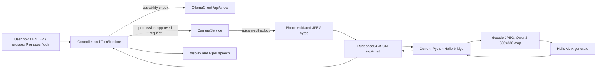

# Qwen3 Vision Migration Audit

Status: static audit only. No source, script, configuration, dependency, or
existing documentation was changed for this audit. Findings below are based on
the current checkout; runtime behavior not covered by existing tests is marked
unknown.

## A. Architecture overview

Independence already has a complete permission-gated camera-to-Ollama-shaped
HTTP path. The current Hailo implementation at the end of that path is a
Qwen2-specific Python bridge; Qwen3 has only been proven through the separate
Hailo Apps smoke test, not through Independence.

For Qwen3, the intended replacement boundary is the bridge/backend segment:
one JPEG, decoded and resized to Qwen3's verified 512x288 RGB input, one Hailo
generation, and one response. Camera consent, Rust orchestration, and response
presentation do not need a model-specific rewrite.

## B. File inventory

| File | Purpose / relevant locations | Qwen2 assumption | Action |
|---|---|---|---|
| `src/see/mod.rs:21-110` | Validates JPEG/PNG, stores original bytes in `Photo` | None | Keep |
| `src/see/camera.rs:365-505,620-734` | `rpicam-still` discovery/capture, bounded stdout, cancellation and semaphore | None; produces one JPEG per capture | Keep |
| `src/app.rs:922-1080` | Capability gate and camera permission/preparation | Assumes only boolean `vision` metadata | Keep; modify only if Qwen3 limits need enforcement |
| `src/app.rs:1831-1930` | Explicit user `P` photo capture and queued captures | Allows up to four queued photos | Modify to one photo for Qwen3 |
| `src/app.rs:2302-2477` | Loads/captures photos, passes bytes to client, returns answer | Generic transport; allows a vector | Modify vector contract to one image |
| `src/think/mod.rs:268-496` | `/api/show`, base64 encoding, `/api/chat`, response parsing and telemetry | Ollama-compatible shape, not Qwen2-specific | Keep transport; modify image cardinality/capabilities |
| `src/think/mod.rs:680-736` | Builds final user message with `images` | Generic Ollama JSON | Keep or simplify to one image |
| `src/profile.rs:145-232` | Pi Hailo profile selects `hailo-vlm`, model and loopback URL | `HAILO_VLM_MODEL` is Qwen2 alias | Modify model default only |
| `tools/hailo_vlm_bridge.py:31-220` | Hailo backend, JPEG decode and preprocessing | `qwen2-vl:2b`, 336x336 center crop, multi-frame list | Replace Qwen2 path with Qwen3 512x288 single-frame path |
| `tools/hailo_vlm_bridge.py:280-493` | `/api/show`, `/api/chat`, base64 decode, max-four validation | Advertises vision but accepts up to four images | Modify to advertise/validate one image |
| `scripts/run_pi_hailo_vlm_bridge.sh:1-75` | Activates Hailo Apps and starts bridge | Searches only for Qwen2 HEF | Modify or replace for explicit Qwen3 HEF |
| `scripts/prepare_pi_hailo_vlm.sh:69-95` | Installs Hailo Apps GenAI deps/downloads Qwen2 resource | Downloads/selects Qwen2 | Remove or replace for Qwen3; do not reuse unchanged |
| `tools/tests/test_hailo_vlm_bridge.py` | Hardware-free bridge contract tests | Tests Qwen2 defaults, dimensions and four-image behavior | Modify tests for Qwen3 |
| `tools/tests/test_pi_hailo_shell_scripts.py` | Shell wrapper tests | Tests Qwen2 resource selection | Modify/remove Qwen2 cases |
| `docs/raspberry-pi-hailo.md` | Current implemented Hailo runbook | Entirely Qwen2/5.1 bridge path | Mark obsolete or replace with Qwen3 guide |
| `docs/raspberry-pi-hailo-qwen3.md` | HailoRT 5.3/Qwen3 installation and standalone smoke test | Correctly documents standalone Qwen3, explicitly says bridge is not migrated | Keep as setup evidence; update only after implementation |
| `docs/raspberry-pi-independence.md` | Base Pi setup and links | Links to both old and new paths | Update links after migration |

## C. Qwen2 assumptions

Verified Qwen2-specific assumptions are concentrated in the Python bridge and
setup wrappers: `DEFAULT_MODEL = "qwen2-vl:2b"` and `VLM_IMAGE_SIZE = 336`
(`tools/hailo_vlm_bridge.py:31-48`); the backend comment and crop implementation
at lines 209-228; up to four images at lines 472-493; and Qwen2-only HEF
discovery in `scripts/run_pi_hailo_vlm_bridge.sh` and
`scripts/prepare_pi_hailo_vlm.sh` (their `qwen2` filename filters).

Rust's model-specific value is in `src/profile.rs:147-151` via
`HAILO_VLM_MODEL`; the rest of Rust uses the generic Ollama-compatible model
name and `vision` capability. Rust does not contain Qwen2 dimensions, HEF paths,
or Hailo API calls.

The existing four-image behavior is real, not hypothetical: `src/app.rs:1853`
limits queued captures, and `src/app.rs` tests include
`repeated_p_presses_submit_four_photos...` near line 3846. The bridge also
constructs one Hailo frame for every supplied image (`tools/hailo_vlm_bridge.py:157-161`).

## D. Python migration plan

Must change:

1. Replace Qwen2 constants, comments, HEF discovery, and 336x336 center-crop
   code in `tools/hailo_vlm_bridge.py` with Qwen3's verified 512x288 RGB
   preprocessing. Preserve local JPEG decoding and bounded input validation.
2. Reject image lists whose length is greater than one, and expose the one-image
   contract in `/healthz` and `/api/show` metadata if the Rust client consumes it.
3. Point the launcher/preflight at the explicit Qwen3 HEF and the already
   verified HailoRT 5.3/Hailo Apps environment. Remove Qwen2 download/search
   instructions rather than leaving a selectable legacy path.
4. Rewrite bridge tests around one image, 512x288 preprocessing, Qwen3 model
   naming, and the existing safe error/telemetry behavior.

Already working and should remain: loopback binding, request-size bounds,
base64 decode, JPEG decode, serialized generation, context clearing, response
parsing, and telemetry that excludes prompts and image bytes.

The Qwen3 setup guide proves Hailo Apps' standalone `VLM.generate` path, but it
does not prove that this bridge's prompt shape and preprocessing are accepted by
Qwen3. That is a runtime integration test, not a documentation assumption.

## E. Rust migration plan

The camera implementation and permission gate should remain untouched. The
minimal Rust changes are:

- Change `src/profile.rs:147-151` to the Qwen3 local model alias/endpoint
  contract after the Python service chooses its final name.
- Change `src/app.rs:1831-1876` and draft photo state so Qwen3 accepts one
  captured photograph; remove the four-photo queue behavior and its tests.
- Change `src/app.rs:2318-2456` and `src/think/mod.rs:410-496` from a vector
  image request to one optional image, or retain an internal vector only if it
  is immediately constrained to length one. The latter is less disruptive but
  leaves obsolete semantics.
- Extend capability metadata only as needed to represent `max_images=1` and
  `video=false`; do not infer these from a model name.

Untouched: `Photo` validation/storage, rpicam process management, cancellation,
camera consent events, history handling, answer display/speech, loopback URL
validation, and privacy telemetry policy.

## F. Image transport findings

Verified statically: `rpicam-still` writes JPEG bytes to Rust stdout
(`src/see/camera.rs:419-501`); `Photo::from_camera_jpeg` validates and stores
those exact bytes in memory (`src/see/mod.rs:78-110`); `run_turn_with_interaction`
passes `Photo::bytes()` to `OllamaClient` (`src/app.rs:2446-2456`); and
`OllamaClient` base64-encodes the bytes into the final user message
(`src/think/mod.rs:474-496,695-710`). The bridge base64-decodes them and uses
OpenCV `imdecode` (`tools/hailo_vlm_bridge.py:480-492,196-207`). No intermediate
file is used in the Independence path.

The bytes therefore appear preserved correctly from camera to Python. Static
inspection cannot prove the real Camera Module 3 JPEG reaches Qwen3 correctly;
the current bridge crops it for Qwen2 and accepts multiple images. A real camera
request through the migrated bridge remains required.

## G. Recommended implementation sequence

1. Add/adjust a hardware-free bridge contract test for one base64 JPEG and
   Qwen3 constants.
2. Replace bridge preprocessing and model/HEF selection with the proven Qwen3
   path; keep the loopback API and safe telemetry.
3. Make Rust send and accept exactly one image and disable additional `P`
   captures for the Qwen3 profile.
4. Update profile/setup scripts and remove Qwen2-only runbook instructions.
5. Run unit tests, then on the Pi: `/api/show`, bundled image request, direct
   Camera Module 3 request, and a voice/photo turn. Check power before and after.

## H. Open questions

- Does Qwen3 accept the current bridge's prompt content-item structure exactly,
  or does the standalone Hailo Apps example require a different prompt template?
- Does Qwen3's Python API require any additional generation parameters or
  context reset behavior beyond the current bridge call?
- What response latency and memory/power envelope occur with a real 1280x720
  Camera Module 3 JPEG after 512x288 preprocessing?
- Should the API report capability fields beyond `vision`, `max_images`, and
  `video`, and where should Rust enforce them?
- Which final local model alias should replace `qwen2-vl:2b` without implying an
  Ollama model exists?
- Does any user-facing command or test outside the files inventoried above
  still rely on the old bridge's four-photo behavior?

## Summary

1. Must change: `tools/hailo_vlm_bridge.py`, both Hailo shell wrappers,
   `src/profile.rs`, the single-image portions of `src/app.rs` and
   `src/think/mod.rs`, and their tests.
2. Can be removed/simplified: Qwen2 HEF download/search logic, 336x336 crop,
   four-image queue/validation, and the old Qwen2 runbook path.
3. Should remain untouched: camera capture/permission, `Photo` validation and
   byte storage, local HTTP safety, cancellation, response presentation, and
   privacy telemetry.
4. Most important tests: real Camera Module 3 JPEG through the migrated bridge,
   exact Qwen3 prompt contract, one-image enforcement, and power/thermal
   stability during inference.
5. Estimated scope: one focused integration milestone: primarily one Python
   bridge rewrite plus a small Rust single-image/profile change, with targeted
   tests and Pi verification; no repository-wide redesign is indicated.
