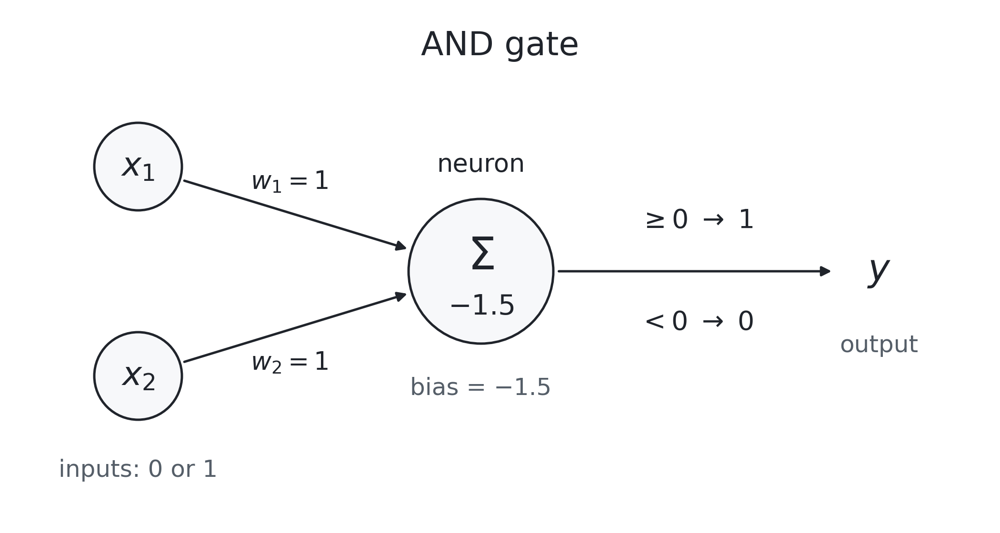

how do you _feel_, in your bones, your heart, and your stomach? how much are you enjoying your life, versus just trying to get through each day? how much of the time are you frustrated? how much of the time are you thinking existentially? and, how much of the time are you spiraling?

what would it feel like to disconnect from the world and walk around your neighborhood for an afternoon? when's the last time you did that? 

i believe people are only as strong as the community supporting them. in my worst times and my best times, it is my friends and family i fall back on. i am trying to write more, and take more chances, because the worst case is embarrassment and failure. i already embarrass my friends and family. if i'm not failing, am i trying?

below, i will try to demystify the workings of a neural network (aka a "model"). ultimately, i hope to motivate people to take a moment and trust how using this technology, in the way it’s designed, feels. if you have no interest in that, i ask that you take a walk, or reach out to someone you haven't talked to in a while, or make dinner for your friends. perhaps read a page of something you don't understand, and then read it again because you didn't understand it the first time. if you do it once, you will do it again. and you'll judge less; you'll be more curious. 

i think people underestimate the value of one positive, motivated idea. and i hope to be someone that amplifies the pure energy that is within all of us. i am reading a book called _practical electronics for inventors_ and i'm learning how much i don't know and _feeling_ how hard it is to learn something new. i'm stuck on chapter 2 learning about current and voltage. my friend harnek chuckled watching me read the same chapter three days in a row. there's one example in the book about how electrons move through a circuit. 

image of battery.

when you hook up a battery to a closed circuit, the negatively charged electrons push each other towards the positive side. each electron barely moves, but the "push" moves at close to the speed of light as each electron bumps into its neighbor. imagine 100 dominoes. you push the first domino and that domino barely moves an inch. but the impact goes as far as the dominos go. i think humans, at their best and at their worst, are very similar. the people we impact the most are the people nearest to us. but that impact permeates at the speed of light towards others. as you push the people near you, you push everyone. and ultimately that energy moves faster than anything else in our universe. _star wars_ calls this "the force". i imagine it like this:

 

## a neural network example
the first thing you learn in a computer science systems class is "boolean logic." it's the basis of every computation done in hardware. the complex systems that exist today are built from these primitives. one such example is the AND gate. an AND gate requires both inputs (let's say A and B) to be true for the output to be true. below is an example of "data" you give the model to "learn."

| Input 1 \(x_1\) | Input 2 \(x_2\) | Expected output \(y\) |
|---|---|---|
| 0 | 0 | 0 |
| 0 | 1 | 0 |
| 1 | 0 | 0 |
| 1 | 1 | 1 |

a neural network has 1) "inputs" -- in this example A and B, 2) "connections" (aka "weights") -- values that amplify or reduce the impact of any input or neuron on one another, 3) "neurons" (combine inputs, weights, and bias), and 4) "outputs."  below is an example of a neural network that solves AND gate boolean logic. the example has three parameters. with these three parameters, a simple neural network can solve the AND Boolean logic of two inputs. so if you ask an LLM what's the result of "AND-ing" 1 and 1 or "AND-ing" 1 and 0, this neural network will give you the correct output.

the equation is:

$$
z = w_1x_1 + w_2x_2 + b
$$

$$
y =
\begin{cases}
1 & \text{if } z \geq 0 \\
0 & \text{if } z < 0
\end{cases}
$$

and here is how you would calculate each combination of inputs:

| Input \(x_1\) | Input \(x_2\) | Calculation | Output |
|---|---|---|---|
| 0 | 0 | \(0 + 0 - 1.5 = -1.5\) | **0** |
| 0 | 1 | \(0 + 1 - 1.5 = -0.5\) | **0** |
| 1 | 0 | \(1 + 0 - 1.5 = -0.5\) | **0** |
| 1 | 1 | \(1 + 1 - 1.5 = 0.5\) | **1** |

you may hear that a certain model has "X billion parameters." for example, these big tech companies that suck are creating models with more and more parameters. parameters are just "neurons" plus "connections". so"bias" plus "weights" equals the number of parameters of a model. as you can imagine, billions of parameters start to look pretty hard to understand. and _they don't understand it_!! nobody can understand something like that. but they try, and there are plenty of researchers who are paid a lot to try. but ultimately, they don't know how it works. and their own biases, present in the data they give the model to train, manifest in the network's biases. here's an example of a fully connected neural network:

i hope this helps demystify the inner workings of a neural network, the core engine of these trillion-dollar companies. open source versions of these neural networks exist and we can bias them towards making _people_ more capable instead of stripping away everything that makes them feel human. but that's for another day.
