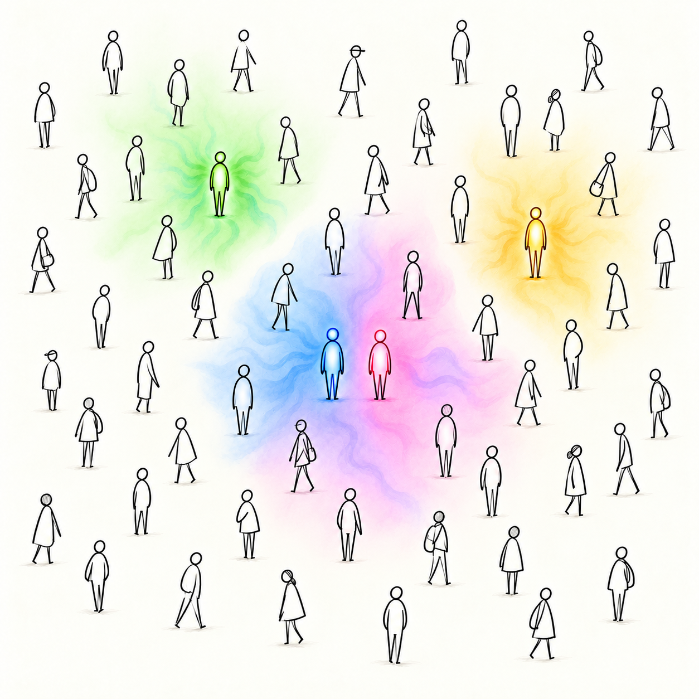
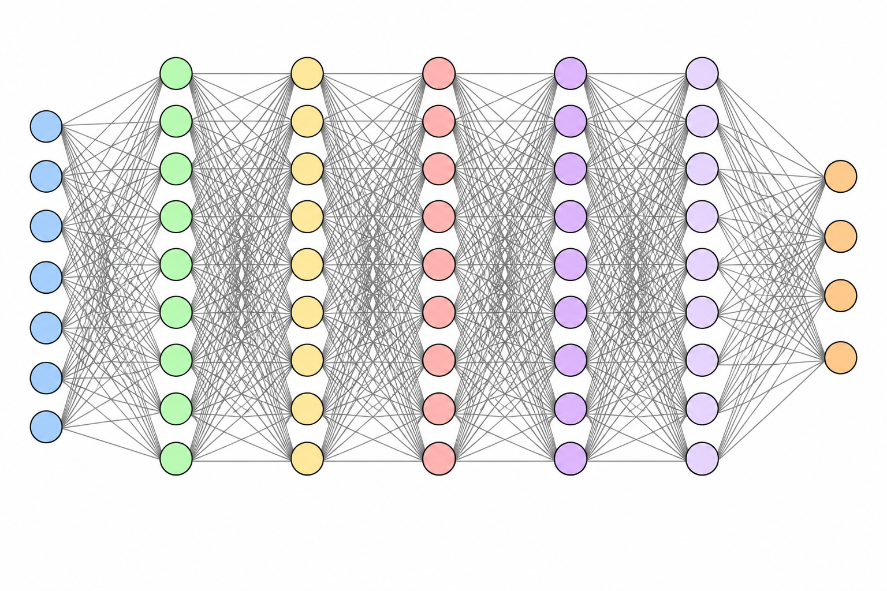

how do you _feel_, in your bones, your heart, and your stomach? how much are you enjoying your life, versus just living it? how much of the time are you frustrated? How much of the time are you thinking existentially? and, how much of the time are you spiraling?

what would it feel like to disconnect from the world and walk around your neighborhood for an afternoon? when's the last time you did that? 

i firmly believe humans are only as strong as the community of people supporting them. in my worst times and my best times, it is my friends and family i fall back on. i am trying to write more, and take more chances, because the worst case is embarrassment and failure. I already embarrass my friends and family; if i'm not failing, am i trying?

below, i am trying to demystify the workings of a neural network. then, i will try to explain leverage in our economy, based on this technology, and show how it's strips us of our most basic human fulfillment. ultimately, i hope to motivate people to take a moment and trust how using this technology, in the way it’s designed, feels. if you have no interest in that, i ask that you take a walk, or reach out to someone you haven't talked to in awhile or make dinner for your friends. perhaps read a page of something you don't understand; and then read it again because you didn't understand it the first time. if you do it once, you will do it again and you'll judge less; you'll be more curious. 

the end result should be a pure energy permeating out of each living being. star wars calls this the "force". i imagine it like this:

i've been reading this book called "practical electornics for inventors" and i'm learning how much i don't know and _feeling_ how hard it is to learn something new. i'm still stuck on chapter 2 learning about current and voltage. there's one example in the book about how electrons move through a circuit. when you hook up a battery to a closed circuit, the battery has positive and negatively charged sides. the negatively charged size basically pushes electron. but each individual electron doesn't move very much. but the "push" moved at the speed of light as each electron bumps into its neighbor. i think humans, at their best, and at their worst are very similar. the people we can impact the most are the people near us. but as you push the people near you, you push everyone. and ultimately that energy moves faster than anything else in our universe.

little battery image. 

## a neural network example
the first thing you learn in a computer science systems class is "boolean logic." it's the basis of every computation done in hardware. from these primitives are built the complex systems we have today. one such example is the "AND" gate. an "AND" gate requires both inputs (let's say A and B) to be true for the output to be true. this is the "data" you give the model to "learn."

table

you can build a neural network that solves this. a neural network has "inputs", in this example A and B, it has neurons, it has outputs, and connections between those three types. if you're a visual learner, here's a diagram below. the "weights" are teh connections and the neuron's hold the "bias." the bias is just any number.

you may here that a certain model has "X billion parameters". for example, tehse big tech compabies that suck are creating models with more and more parameters. parameters are just "neurons" plus "connections". so "bias" plus "weights" equals the number of parameters of a model 

our example above has three parameters. with these three parameters, we can solve AND boolean logic of two inputs. so if you ask an LLM whats the result of "AND-ing" 1 and 1, the nerual network above would figure that out.

the equation is:

$$
z = w_1x_1 + w_2x_2 + b
$$

$$
y =
\begin{cases}
1 & \text{if } z \geq 0 \\
0 & \text{if } z < 0
\end{cases}
$$

as you can imagine, billions of parameters starts to look pretty hard to understand. here's a fully connected neural network:

and _they don't understand it_!! nobody can understand something like that. but they try and their own biases, for lack of a better word, get are manifested in the network's biases. 

## the leveraged economy

## putting both together
when you put a technology that nobody really understands together with inherent biases of the people that train the models (give it data to learn), with a highly leveraged and speculative economy, you introduce incredible risk to humanity. 

how does using ai feel to you these days? does it make you more curious? does it make you frustrated? when it's "thinking," what are you doing? 
