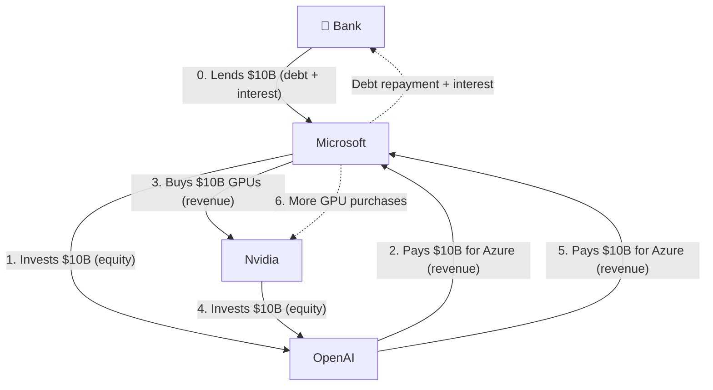

# think of the feeling you want and the feeling you want others to have and chase it 
its a little more positive than the last one. 

# the leveraged economy and what that means for people who don't give af about anthropic, nvidia, google and openai or believe in their mission

- explain the leveraged economy in simple terms
bob, alice, austin
- learning for sam
here's an example of the leveraged econmomy. microsoft thinks openai is great so they want to invest.

they send $10 billion to openai, that means open ai received investment capital, they then spend that $10 billion ono cloud infrastructure hosted by microsoft, that $10 billion is now marked as revenue (its the same $10 billion they just gave away/invested) so they took cash from their balance sheet and prettym uch just made it revenue. microsoft then uses that $10 billion to by GPUs from nvidia. 
so in essence, they are borrowing against expected ai revenue growing. and they're borrowing a lot. when it comes crashing down, people with 401ks, iras, pensions that are exposed to thsee stocks will see susbtantial losses. 

this exact issue was deatiled by the bank for intenrational settlements on october 27 https://www.bis.org/publications/bulletin-140-building-ai-credit--structures-and-spillovers

the issue then becomes that this props up valuations. 
- then explain what that means for "regular" people not in the top 1%

- then explain that even with a success, which seems _plausible_(?), the success path is rife with pain and suffering for the average person
 - capitalsom only works when wealth created by businesses is then taxed and redistributed quickly and efiicently. how many people believe our government will do that? 
 - so pie example again ( | ) 50% change the leveraged economy succeeds, 50% chance it fails bringiny x,y,z
 - now lests talk about the success half: massive job disruption from engineers to mathematicians, to truck drivers to cleaners, to warehouse workers, 

 the future being fortold is super abundance of food but what makes you think any of the avg of these billionaires (sorry trillionaires?) give a flying fuck about creating a super abundance of food? 

 now this doesn't mean i fundamentally dislike AI. ai, in its most beutiful incarnation, is the compaction of knowledge that can be used to search, query, understand every topic known to humans in a way that's greater than, perhaps, the greatest of teawchers. i disagree with how its been created (stolen) and how its being redistributed (behind a paywall and obfuscating the underlying techonology which is actually quite simple in the result, but infinitely complex in the creation with even some calling it a "mirror of g-d" -- podcast jared sent me. 

so now, to try to demistify the technology, i will do my best to explain this as if i'm talking to my family and friends. 

a book 
a science journal
.
.
.

i need a better way of describing how data leads t ooputut

the better the data, the better the output. you need data that is _correct_. and there is only so much of that out there. so you have to be extremely careful not to give it incorrect information; a textbook where the formula is incorrect, an image that is marked as having an oak tree but its actually a maple. 

hallucinations are pretty much bad data combined into extremely bad output. x leads to y leads to z

and then the true magic is in its compaction and its ability to create and explain. so you compact all of that knowledge into "weights". weights are literally values between 0 and 1. so a weight could be 0.02420 or 0.75

this is what you hear as "parameters". you'll hear there's a model with 3 billion parameters and the newest models _generally_ have more parameters (aka weights, aka numbers between 0 and 1) 

these weights are then combined into a "network" or i've been recently thinking of it as a lattice (if you've ever studied chemistry, a lattice of ions looks like this)(shoutout my friend harnek for helping me understand a lattice as i've been reading this book that is curriculum for berkeley's physics calss "physics for scientists and engineers") and he was an instructor for a very similar class!

so imagine each of these little balls is a weight and each ball is connected in some somewhat random way (show these connectinos) with weights.

* learning for sam. what does the input look like, what does the output look like 

here's a simple example for a flipped coin (or no its an equation)? theres a really simple example for this

feel free to skip it if you hate math equations. i don't want to scare you off. but for those who have studied electronics or cs, this is an example of how you teach a neural network (system of weights) to get an AND function correct. 

the connections between the input and neurons or neurons can be any real number. a positive weight increases the sum, a negative weight reduces it and a zero weight means it contributes nothing. an example of a zero weight (it might discover that one of the inputs in an equation doesnt matter. for exmaple your grammar or mispellings should have no impact on the result of your question. things like that. ) but you don't realaly know hat it has discovered. 

you have a bias on every neuron and then at the end there's an "activation function" which is jsut a rule. if at thend the result is greater than 0, output a 1. if at the end the result <= 0, output a 0.

so if you look at our table here
for these smiple examples we can solve them for oourselves. we find the b value that makes the activation function correct. when training the model is finding the weights and the bias. so the result is you've taught a neural network to do boolean logic. 

 but in our "billions of parameters" examples, the model just starts adjusting weights and biases on neurons until it can satisfy al lof the data you have correctly. the more complex the data and the input, the more parameters you generally need to satisfy the outputs. and this is why the data matters so much. if you have bad data, you train the model incorrectly (bad weights, bad biases) and so you get bad results when used after creation. 

so in sum, they pretty much have no idea how this works when it gets to more complex things, but the idea is the same. and the important part is the data (which they;ve stolen)

so data is super improtant. how are they continuing to get new data. well, we, the users of their platform are giving them so much data on how humans think and on how to take advantage. for exmapl,e privacy is a myth with these companies. their privacy policies indicate they can't look at your data. whiebc means no single person is looking at the queries you make and building a profile of you. but their code is. they can build a profile of you by analyzing your queries _without_ peopel looking at them. and then they can create an n-dimesnional profile of you. for example dimenstion could be insecurity, arrogance, naivettee, courage, relationships with family, and they put you on a point in a graph that is insanely complex and they know you. without, technially, looking at your data. its extremely deceptive 

llitatle graph on deception/lying. where as you get more deception you aproach the line of lying 

so how do you fight back. htei entire business model is based on being the arbiter of knowledge. there are two vectors they can play with 

- increase their knowledge
- decrease yours

how do you _feel_ when you use it? how much ofthe time are you enjoying it? everyting i am saying is conjecture, opoinion. 

but hwo do you _feel_, in your bones, when you use it? think abotu how the technology has changed since llms were first first introduced to us a few years ago. they used to be only instantaneuous and now you often wait while _it thinks_. NOT YOU. the technology is not inherentyl bad but the way its beeing used is outsourcing our thining.

but despite all of this ,there are ways of fighting back that have never been more vailable. think of the feeling you want and the feeling you want others to have and chase it.

now what can you do ? i strongly believe we are only as strong as the community of people we have in our life. reach out to the people you havne't talked to in a while, chat with your neighbor, make dinner for your firnds, make love, read a page of omehting you're tyring to learn. hten read it again when dyou didn't udnerstand it the first imte. learn about the world. people that know me knowi don't know nearly enough. we have to build oursevls up from ourselves outwards. 

then beautifl image of blu, punk person shining and joinging. and we shoud l==all shine llike children do. 

show a complext example of a question like how does a diesel engine work? and show how that's a token? and show how that token gets distribtued across weights and then show the output. 

this is hypothetical, not representative of actual borrowing arrangements

now
